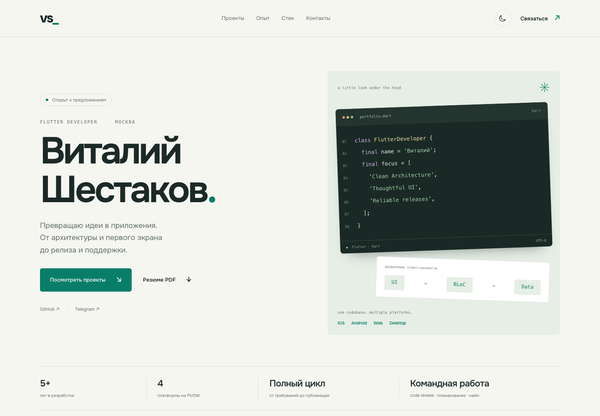

# Виталий Шестаков

**Flutter Developer · iOS / Android / Web / Desktop**

Создаю приложения от проектирования архитектуры и интеграции сервисов до публикации и сопровождения. В коммерческой Flutter-разработке с февраля 2021 года.

[Портфолио](https://vitaliyshestakov.github.io/portfolio/) · [Резюме PDF](resume.pdf) · [Telegram](https://t.me/Shestakov_V) · [GitHub](https://github.com/VitaliyShestakov)



[Полный макет для компьютера](assets/layout-desktop.png) · [Мобильный макет](assets/layout-mobile.png)

- **Место проживания:** Москва
- **Формат:** полная занятость, офис / гибрид / удалённо
- **Готовность к переезду:** Казахстан, Россия; готов к командировкам
- **Email:** [shestakovvitaliy87@gmail.com](mailto:shestakovvitaliy87@gmail.com)
- **Telegram:** [@Shestakov_V](https://t.me/Shestakov_V) — предпочтительный способ связи
- **Языки:** русский — родной; английский — B1
- **Статус:** открыт к предложениям

## О себе

Разрабатываю приложения для iOS, Android, Web и Desktop. Уделяю внимание поддерживаемости кода, производительности и удобству интерфейсов. Самостоятельно прорабатываю технические решения, декомпозирую задачи, оцениваю сроки и планирую работу.

Участвую в code review, технических собеседованиях и обмене знаниями внутри команды. Использую ИИ-агентов при разработке: настраиваю проектный контекст и инструменты, проверяю корректность и качество предлагаемых изменений.

## Опыт работы

### Октябрь 2023 — настоящее время · Terra Club

**Flutter-разработчик · iOS / Android / Web**

Приложение сообщества: личный кабинет, мероприятия, волонтёрские программы, наставничество, образовательные направления и контент.

- Участвовал в полном цикле: требования, архитектура, оценка и распределение задач, реализация, интеграция с серверной частью, тестирование, релизы и поддержка.
- Разрабатывал адаптивные интерфейсы, авторизацию, профиль, каталоги и карточки мероприятий, запись на активности и уведомления.
- Развивал архитектуру на BLoC с разделением UI, бизнес-логики, репозиториев, сетевого и локального слоёв. Работал с REST API и WebSocket.
- Принимал технические решения, проводил code review, координировал работу команды и участвовал в планировании.
- Проводил технические собеседования; участвовал в передаче знаний, проекта, документации и доступов при смене участников команды.

[Сайт компании](https://club-terra.ru/)

### Август 2022 — сентябрь 2023 · Citadel.one

**Flutter-разработчик · iOS / Android**

Криптовалютный кошелёк на Flutter.

- Интегрировал WalletConnect для подключения к Web3-приложениям.
- Добавлял и поддерживал интеграции с децентрализованными приложениями — DApps.
- Работал с криптовалютными API: получение балансов, отправка и получение токенов.
- Обрабатывал состояния загрузки, ошибки запросов и статусы транзакций.
- Согласовывал изменения API с командой и дорабатывал связанные функции кошелька.

[Сайт компании](https://citadel.one/)

### Июнь 2022 — август 2022 · Tayyab Central Asia Ltd

**Flutter-разработчик · iOS / Android**

Цифровой исламский финансовый сервис в Казахстане.

- Разрабатывал экраны переводов, истории транзакций и выписок.
- Дорабатывал платежные функции, выпуск и активацию виртуальных и физических карт.
- Исправлял критические ошибки, проводил рефакторинг и участвовал в улучшении архитектуры.
- Дорабатывал UX/UI, адаптивность и доступность экранов; проводил code review.

### Апрель 2022 — июнь 2022 · Beauty Agent

**Flutter-разработчик · iOS / Android**

Приложение для мастеров в сфере услуг.

- Разрабатывал анкеты клиентов: создание, редактирование и просмотр.
- Реализовывал расписание мастера и управление записями клиентов.
- Добавлял регистрацию, авторизацию и push-уведомления.
- Поддерживал мультиязычность и адаптировал интерфейс под разные экраны.
- Участвовал в оценке задач, уточнял требования и вёл задачи в таск-трекере.

### Февраль 2021 — март 2022 · ОТИС, ТОО

**Flutter-разработчик · iOS / Android**

Внутреннее приложение для групп быстрого реагирования.

- Разрабатывал новые экраны и функциональность.
- Интегрировал Google Maps, отображение объектов и геолокацию.
- Реализовывал авторизацию, в том числе через социальные сети.
- Поддерживал WebSocket: входящие события и восстановление соединения.
- Дорабатывал существующий код и исправлял ошибки.

## Технологии

| Направление | Инструменты и подходы |
| --- | --- |
| Flutter и архитектура | Dart, Flutter, Clean Architecture, SOLID, MVVM, MVP, DI, модули и пакеты |
| Состояние и навигация | BLoC / Cubit, Provider, Streams, RxDart, AutoRoute, GoRouter, Navigator |
| Сеть | REST API, Dio, HTTP, WebSocket, авторизация, обработка ошибок |
| Данные | SQLite, Drift, IndexedDB, Hive, Shared Preferences, Flutter Secure Storage |
| Firebase | Authentication, Cloud Messaging, Analytics, Crashlytics; дополнительный опыт с Firestore и Remote Config |
| Интеграции | Google Sign-In, Sign in with Apple, Telegram, AppsFlyer, AppMetrica, Sentry, Intercom, уведомления и deep links |
| UI | Figma, адаптивные интерфейсы, Material / Cupertino, UI-kit, дизайн-токены, Widgetbook, intl, Localizely |
| Качество | Flutter Test, Dart DevTools, Flutter Inspector, flutter analyze, линтеры |
| Генерация кода | Freezed, json_serializable, build_runner |
| Релизы | Git, GitLab CI/CD, GitHub Actions, Fastlane, FVM, App Store, Google Play |
| Дополнительно | Method Channels, взаимодействие с нативным кодом Swift / Kotlin |

### ИИ-инструменты и командная работа

- Cursor, Codex, Claude Code: разработка, анализ кода и рефакторинг.
- Настройка MCP-серверов, контекста проекта и RAG-базы знаний по коду и документации.
- Подготовка проектных инструкций: архитектурные ограничения, соглашения, команды проверки.
- Декомпозиция, подготовка тестов и документации с помощью агентов; обязательная проверка изменений.
- Технические собеседования, планирование, распределение задач, code review и передача проекта.
- Agile-команды; Jira, Trello, Week.

## Образование

**Санкт-Петербургский гуманитарный университет профсоюзов · 2022**

Экономический факультет, прикладная информатика, бакалавр.

---

## О репозитории

Персональное портфолио на HTML, CSS и JavaScript. Без сборки и зависимостей. Шрифты хранятся локально; аналитика и внешние скрипты не подключены.

- Адаптивная вёрстка для телефона, планшета и компьютера.
- Светлая и тёмная темы с сохранением выбора и поддержкой системной темы.
- Раскрывающиеся описания вклада в проекты; ссылки на Telegram, email, GitHub и PDF.
- Навигация с клавиатуры, ссылка пропуска навигации, учёт `prefers-reduced-motion`, стили печати.
- Основное содержание, навигация и описания проектов доступны без JavaScript.

Обложки Terra Club и Citadel.one — авторские графические иллюстрации, не скриншоты приложений. Описания опыта основаны на резюме от 1 ноября 2026 года. Закрытый код рабочих проектов в репозиторий не включён.

### Запуск локально

Откройте `index.html` в браузере или запустите статический сервер:

```sh
python3 -m http.server 8000
```

Затем откройте <http://localhost:8000>.

### Структура

```text
index.html       — содержание и разметка
styles.css       — адаптивная вёрстка, темы, печать
theme.js         — выбор темы до первого отображения
script.js        — переключатель темы и навигация
resume.pdf       — исходное резюме
assets/          — шрифты, favicon и превью макета
```

### GitHub Pages

Сайт публикуется из ветки `main`, каталога `/ (root)` через GitHub Pages. Файл `.nojekyll` отключает обработку Jekyll. Изменения в `main` обновляют сайт автоматически после сборки Pages.

Контент редактируется в `index.html` и `README.md`, цвета — в переменных в начале `styles.css`. При замене `resume.pdf` ссылка на скачивание сохраняется.

Шрифт **Onest** распространяется по [SIL Open Font License](assets/Onest-OFL.txt).
